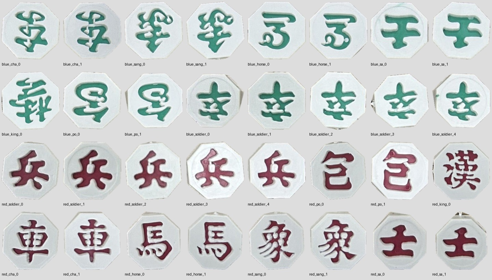
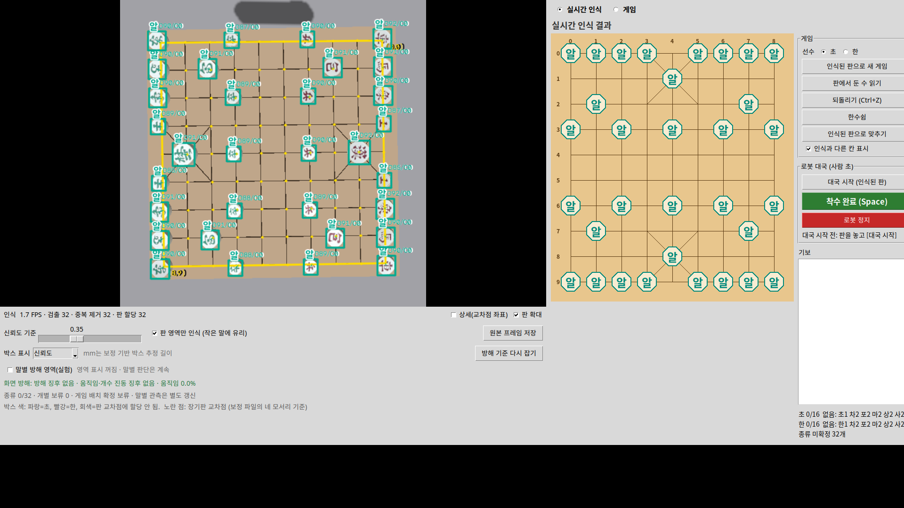
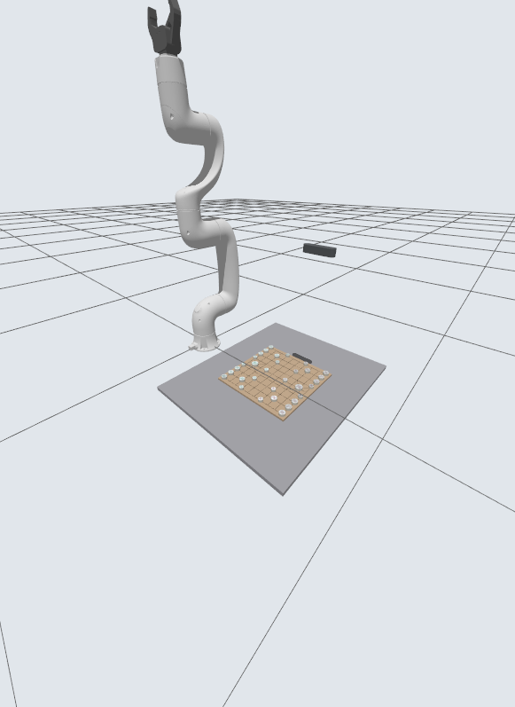

# Gazebo 카메라 → 기존 hybrid UI → 가상 드라이버

기존 실시간 UI `janggi/realtime_ui/run.sh`에서 `--source gazebo --model-mode hybrid`로
Gazebo D455f의 실제 렌더링 영상을 받는다. `SimWorker`, 가짜 검출, 무작위 사람 수,
자동 시나리오를 이 경로에서 사용하지 않는다. 로봇 대국은 `--robot`을 함께 지정하고
사용자가 UI 버튼을 눌러 진행한다.

## 실행

기존 Gazebo·드라이버·`sim_app.py` 창을 종료한다. 새 launch가 장면까지 생성하므로
별도 `run_sim_app.sh --gazebo --setup-only`를 실행하지 않는다.

```bash
# 터미널 1: workspace 루트
cd ~/doosan_janggi_ws
source /opt/ros/jazzy/setup.bash
source install/setup.bash
ros2 launch src/janggi/robot_game/sim_gazebo.launch.py

# 터미널 2: 기존 실시간 UI
cd ~/doosan_janggi_ws/janggi
./realtime_ui/run.sh --source gazebo --model-mode hybrid --robot
```

영상만 확인할 때는 `--robot`을 생략한다. `--source gazebo`에서 모델 옵션을 생략하면
hybrid를 선택한다. 실물 입력 기본값 `--source realsense`는 유지한다.
Gazebo 영상 입력의 로봇 대국은 URDF에 `mode=virtual`, `host=localhost/127.0.0.1/::1`이
명시된 드라이버만 허용한다. 영상 입력만 선택했다고 실물 로봇을 움직이지 않는다.

1. 카메라 영상의 인식 결과와 말 종류를 확인한다.
2. `[대국 시작 (인식된 판)]`을 누른다. 이때 기존 대국 코드가 관찰 자세로 이동한다.
3. 사람 차례에는 물리 접촉 또는 외력으로 말을 움직인다. 오른쪽 판 클릭에 의한 장면 좌표 변경은 비활성화했다.
4. 바뀐 Gazebo 영상을 다시 인식하는 것을 확인한 뒤 `[착수 완료]` 또는 Space를 누른다.
5. 엔진·집기 코드가 가상 드라이버에 명령을 보낸다. Gazebo는 `joint_states`를 목표값으로 받아
   토크 PID로 관절을 구동한다. 실제 링크·말 위치는 물리 엔진의 결과다.

가상 부착·목적지 스냅·직접 말 이동 토픽은 제거했다. 허공을 잡으면 말이 따라오지 않는다.
기본 그리퍼 메시와 보정 TCP(+222mm)의 형상 차이는 여전히 실제 접촉 집기의 제한이다.
실제 장착물·연장 손가락 치수를 확인하기 전에는 성공적인 집기를 보장하지 않는다.

## 전체 경로

```text
실물 calibration.yaml + scene.yaml
           ↓ 시뮬레이션 전용 좌표·픽셀 재계산
config/gazebo_calibration.yaml
           ├─ 판/격자/카메라 SDF, 수평 테이블
           └─ UI 매핑·크기 추정·로봇 목표 좌표

Gazebo Sensors(ogre2)
 → RGB Image → Gazebo Transport 직접 구독 → GazeboSource → 기존 Worker
 → 위치 YOLO → Crop → MobileNet CNN → 크기 가중치·추적·안정화
 → 기존 대국 UI → Fairy-Stockfish → BoardMover / PiecePicker
 → Doosan virtual 드라이버 → joint_states 목표 → 토크 PID → 동적 URDF 링크 → 접촉·마찰 → 말 이동
```

`GazeboSource`는 `sensor_msgs/Image`를 BGR로 변환하고 최신 미소비 프레임만 전달한다.
행 패딩(`step`)을 처리하며, 입력이 중단되면 예전 영상을 계속 재사용하지 않고 오류를 표시한다.
별도 ROS Context를 사용해 영상 입력 종료가 로봇 제어 Context를 종료하지 않게 했다.

## 받침 높이·판 두께·보정

| 항목 | 현재 설정 |
|---|---|
| 로봇 원점 | `base_link = Gazebo world (0,0,0)` |
| 회색 받침 윗면 | **수평 Z=−30mm** |
| 나무판 두께 | **10mm** |
| 나무판 외곽 | 400×400mm 정사각형, 사용자 추정값 |
| 검은 격자 위/아래 | 356.34 / 359.09mm |
| 검은 격자 왼쪽/오른쪽 | 354.61 / 354.58mm |
| 판 회전 | 기존 yaw 약 −90.00048°만 유지, roll/pitch=0° |
| 판 윗면 / 아랫면 | Z=−20mm / Z=−30mm, 받침에 수평으로 밀착 |

400mm 외곽이면 검은 격자 바깥에 약 20~23mm 여백이 남으므로 기하학적으로 타당하다.
외곽 크기는 실측 확정값이 아니다. 판은 yaw(Z축 회전) 방향만 남기고 수평으로 놓았다.
판 윗면 전체는 Z=−20mm이고, 10mm 아래의 아랫면 전체가 받침 윗면 Z=−30mm에 닿는다.

기존 실물 보정의 판 높이는 이 새 치수와 다르다. 따라서 **실물 보정 원본을 수정하지 않고**
`simulation_calibration.py`가 별도 `config/gazebo_calibration.yaml`을 만든다.
판 중심의 XY와 격자의 평면 형상·크기 및 yaw를 보존하고, roll/pitch와 미세한 비평면 잔차를 제거한다.
수평으로 펴면서 네 모서리의 XYZ를 함께 재계산한다. 카메라 위치·자세는 기존 보정 그대로다.
판 높이가 바뀌었으므로 격자 픽셀, 판 평면, 로봇 보정 지점 Z를 함께 갱신한다.
Gazebo는 이상적 핀홀 모델이어서 시뮬레이션 보정의 왜곡 계수는 0으로 설정한다.

설정 변경 위치: `src/janggi/robot_game/config/scene.yaml`.
launch 및 `--source gazebo`에서 시뮬레이션 보정 파일을 필요할 때 갱신한다.

## 카메라와 ROS 토픽

D455f 외형은 124×29×26.8mm의 단순 모델이다. RGB 광학 중심은 base 기준
(613.455, 88.593, 575.542)mm, 자세는 저장된 `T_base_camera`를 따른다.
Gazebo의 전방 +X와 ROS optical의 전방 +Z 사이 축 변환을 적용했다.

| 선택적 ROS 토픽 (`camera_bridge:=true`) | 내용 |
|---|---|
| `/janggi_sim/d455f/color/image_raw` | 실제 렌더링 RGB, 외부 ROS 프로그램용 |
| `/janggi_sim/d455f/color/camera_info` | 1280×720, 보정 내부 파라미터 |

광학 프레임은 `sim_d455f_color_optical_frame`이며 정적 TF도 발행한다.
fx=647.469788, fy=646.709167, cx=643.897827, cy=366.739136이다.
현재 센서는 `rgbd_camera` 대신 **RGB 전용 `camera`**를 사용한다. 깊이 영상과 포인트 클라우드를
생성하지 않으며, 깊이 ROS 브리지도 제거했다. 월드/태양 그림자와 센서 시야 표시도 끄고,
Gazebo CameraInfo와 정적 TF는 보정·좌표계 연결용으로 유지한다.
UI와 녹화기는 원본 직접 수신을 기본으로 사용하므로, 무거운 ROS 영상 브리지도 기본 OFF다.
외부 ROS 영상 소비자가 있을 때만 launch에 `camera_bridge:=true`를 지정한다.
정적 TF는 브리지 활성화 여부와 무관하게 발행한다.
기존 인식·집기와 원본 녹화 경로는 RGB와 판 평면을 사용한다. RGB 해상도·투영행렬·30Hz 설정은 유지했다.

변경 적용 시 UI와 Gazebo launch를 Ctrl+C로 종료하고 첫 터미널부터 다시 실행한다.
기존 실행에 UI만 다시 연결하면 이전 RGB-D 센서가 계속 남는다.

격리 실행에서 Gazebo 토픽은 `/janggi_sim/d455f/image`, `/janggi_sim/d455f/camera_info` 두 개만 확인했다.
[발행 토픽 검증 기록](analysis/gazebo_calibrated_scene/rgb_only_validation.json)을 참고한다.

## 로봇과 말의 동작 범위

로봇은 질량·관성·충돌 형상이 있는 하나의 동적 URDF 모델이다. 베이스만 world에 고정한다.
팔 6축과 그리퍼 4축은 Gazebo `JointPositionController`의 토크 PID로 제어한다.
`use_velocity_commands=false`이며, entity pose·joint position을 강제로 덮어쓰지 않는다.
에뮬레이터 피드백은 목표 각도다. Gazebo의 실제 각도는 하중·접촉·PID 오차로 달라질 수 있고,
`/janggi_sim/physics/joint_states`(Gazebo Model 메시지)로 발행한다.

말은 두께 5mm의 동적 원통 충돌체다. 중력·관성·마찰을 적용한다.
실측 질량이 없어 플라스틱 밀도 **1,200kg/m³**를 가정했다. `config/scene.yaml`의 `pieces.density`로 조절한다.
소형 약 **2.434g**, 중형 **3.900g**, 궁 **5.921g**이며 마찰 계수는 0.8이다.
판·회색 받침에는 고정 충돌체를 추가했다. 말은 다른 말과 그리퍼에도 물리적으로 충돌한다.
초기 배치 이후 코드에서 좌표를 바꾸거나 그리퍼에 강제 부착하지 않는다.

말 지름은 실측 세 그룹 평균(소형 22.729 / 중형 28.767 / 궁 35.448mm)을 쓴다.
말 윗면에는 사용자가 제공한 고해상도 사진 `docs/IMG_1183.jpg`(3024×4032)를 사용한다.
`tools/crop_gazebo_piece_photo.py`가 원본 해상도에서 **32개 말 각각의 윗면**을 추출한다.
흰 말 윗면의 윤곽 바깥만 투명 처리하고, 글자·색상·사진 질감을 유지한다.
잘라낸 원본 영역은 약 150~260px 크기이며, 512px 텍스처로 저장해도 원본에 없는 세부 묘사가 생기지는 않는다.

`assets/pieces/instances/`에 개별 텍스처 32개가 있고, 장면의 각 말은 고유한 `texture_key`를 유지한다.
같은 종류의 차·포·졸 등도 각각 다른 실물 사진을 사용하며, 이동하거나 잡혀도 자기 텍스처가 유지된다.
기존 합성 검사 도구를 위해 종류별 기본 텍스처 14개도 같은 사진에서 추출했다.
원본 경로·SHA-256·잘라낸 좌표는 `photo_instances.json`과 `provenance.json`에 기록했다.
초의 초록색과 한의 붉은색은 사진 그대로이며, 내부 클래스 ID `blue_*`는 유지한다.
SVG 텍스처는 이번 사진 텍스처로 교체했다. 사진은 외형에만 쓰고 분류 정답으로 넘기지 않는다.



재생성 명령:

```bash
/usr/bin/python3 tools/crop_gazebo_piece_photo.py docs/IMG_1183.jpg
```


## 검증과 캡처



사용자 로봇과 분리한 Gazebo·ROS 도메인에서 기존 UI를 실제 `--source gazebo`와
hybrid 모델로 실행했다. 검출/할당과 종류 분류의 정확도는 구분한다.
이 캡처는 동작 서비스 호출 없이 `--no-motion`으로 찍었다.
관련 자동 테스트 **123개**가 통과했다. 실제 URDF의 Gazebo 링크 위치가 격리된 ROS 관절 피드백을
따라 바뀌는 것도 실시간 `pose/info`로 확인했다. 가상 드라이버의 착수 이동 서비스는 이 검증에서 호출하지 않았다.
[검증 수치 기록](analysis/gazebo_calibrated_scene/layout_and_validation.json)을 참고한다.
관련 테스트에는 영상 RGB/BGR 변환과 행 패딩, 수평 받침 접촉, 보정 원본 보존,
실제 영상용 픽셀 재계산, 사용자 이동 시 게임판을 직접 변경하지 않는 조건,
TCP 피드백 없는 집기 거부를 포함한다.

일반 사용에서는 Gazebo의 그래픽 드라이버가 필요하다. 검증 환경에서는 강제 소프트웨어 EGL
초기화 문제가 있어 임시 Xvfb/Mesa로 검증했다. 이 설정을 사용자 실행에 강제하지 않는다.

## 이전 가짜 검출 테스트 도구

`sim_app.py` / `sim_check.py`는 기존 합성 파이프라인 테스트용으로 남겼다.
현재 물리 경로와 함께 실행하면 안 된다. 합성 검사 자체는 남겨두지만,
그 도구의 Gazebo 가상 부착 콜백 연결은 이제 허용하지 않는다. 현재 UI 사용에는 필요 없다.

## 외부 근거

- [Intel D455f 사양](https://www.intel.fr/content/www/fr/fr/products/sku/233193/intel-realsense-depth-camera-d455f/specifications.html)
- [공식 D455 URDF](https://raw.githubusercontent.com/realsenseai/realsense-ros/ros2-master/realsense2_description/urdf/_d455.urdf.xacro)
- [RealSense D400 데이터시트](https://realsenseai.com/wp-content/uploads/2025/08/Intel-RealSense-D400-Series-Datasheet-August-2025.pdf)

## 카메라·로봇만 보일 때

서버에는 `board=True, table=True, pieces=32`인데 GUI Entity Tree에 없던 현상을 실제 사용자 실행에서 확인했다.
전체 상태 조회로 판·받침은 나타났지만 말의 시각 요소는 복구되지 않아, 현재 모델 자세를 보관하고
받침·판·말 34개만 새 ID로 재등록해 GUI 표시를 복구했다. 로봇·카메라는 재생성하지 않았다.



새 launch는 `--wait-for-gui`로 GUI 시점 서비스가 준비되고 초기 상태 콜백이 완료된 뒤 모델을 만든다.
GUI의 초기 상태 처리 전 증분 상태 메시지가 무시될 수 있는 동작은
[Gazebo 8 GuiRunner 소스](https://github.com/gazebosim/gz-sim/blob/gz-sim8/src/gui/GuiRunner.cc)에 있다.
이번 증상은 그 초기화 구간과 모델 생성이 겹친 경우로 판단한다.

위 복구 기록은 과거 정적 시각 모델의 기록이다. 물리 모드에서는 동적 물체를 재생성하는
`--refresh-board`를 차단했다. 표시 문제가 있으면 Gazebo launch를 종료하고 재시작한다.

서버에 모델이 있고 시점만 바꾸려면 `--focus-board`를 사용한다.
`janggi_board가 없습니다`라면 실제 장면 생성 실패이므로 첫 실행 터미널의 오류를 확인한다.

## 분류 갱신 주기와 처리 속도

정상적으로 종류가 알려진 말은 기본 처리 프레임 4개마다 CNN을 갱신한다. `알`인 미분류 말은
매 처리 프레임에서 재분류를 요청한다. 기다리는 요청은 최신 프레임 하나로 교체하며,
처리가 0.1초보다 오래 걸리면 모델이 끝난 뒤 다음 최신 요청을 실행한다.
위치 YOLO는 계속 영상 처리 프레임마다 실행한다. 이 설정은 카메라나 UI를 10 FPS로 제한하는 옵션이 아니다.

현재는 깊이·포인트 클라우드 생성을 제거했다. RGB·GUI 렌더링, ROS 영상 복사·전달, YOLO, CNN은 계속 자원을 사용한다.
미분류 재시도를 제한해도 YOLO나 렌더링이 병목이면 전체 FPS 향상은 제한될 수 있다.

```bash
./janggi/realtime_ui/run.sh --source gazebo --model-mode hybrid --robot \
  --classification-interval 0.5 --unknown-classification-interval 0.1
```

## 녹화 재생 격자와 수신 경로 수정

녹화 영상에 실물 보정을 적용하던 자동 선택 문제를 수정했다. 이제 파일 입력은 같은 폴더의
`calibration.yaml`(또는 RealSense 녹화의 `board_calibration.yaml`)을 우선 사용한다.
명시적인 `--calibration`은 항상 우선한다. 알려진 Gazebo 녹화에 보정 사본이 없으면
실물 보정으로 조용히 대체하지 않고 오류를 낸다. 녹화 폴더를 옮길 때 MP4와 보정 파일을 함께 옮긴다.

```bash
# workspace 루트: 녹화 당시 보정 자동 선택
./janggi/realtime_ui/run.sh --source tools/captures/gazebo_20261111_212837_235435/color.mp4 --model-mode hybrid --playback-fps 30
# 실시간 기본 입력은 원본 직접 구독
./janggi/realtime_ui/run.sh --source gazebo --model-mode hybrid --robot
```

ROS 경유를 비교할 때만 Gazebo launch에 `camera_bridge:=true`, UI에 `--gazebo-transport ros`를 지정한다.
ROS 영상 구독은 큰 영상의 손실을 줄이기 위해 Reliable/KEEP_LAST(1)을 사용한다.
재생 영상으로 가상 로봇을 움직이지 않도록, 시뮬레이션 보정이 있는 녹화 파일은 로봇 대국을 켜더라도
`--no-motion` 없이 이동 제어를 시작할 수 없다. 실제 가상 로봇 대국에는 `--source gazebo`를 쓴다.

각 hybrid 세션에는 실제 `inference_device`와 영상 transport를 기록하며, `performance.json`을 5초 간격으로 갱신한다.
영상 입력 대기·위치 YOLO·추적/융합/상태 저장·출력 로깅 시간, CNN 배치 시간과 원본 수신 FPS를 구분한다.
[원인 비교와 실측 결과](analysis/gazebo_playback_diagnosis/README.md)를 참고한다.

말 두께는 5mm다. Gazebo 말 모델과 충돌체의 높이를 맞추고,
실시간 UI의 기본 `--piece-height 5`로 윗면 시차·크기 측정 보정도 맞춘다.
기존 녹화가 12mm 말 모델로 만들어졌다면 재생 시 `--piece-height 12`를 명시한다.

### 물리 모드 검증

[검증 결과](analysis/gazebo_physics_validation/runtime.json): 별도 파티션의 헤드리스 Gazebo에서
30mm 낙하 후 판 위 안착, 32개 동적 말 유지, 토크 PID 관절 응답 및 외력에 의한 말 이동을 확인했다.
실물 그리퍼와의 형상 일치 또는 완전한 집기·놓기 성공 검증은 포함하지 않는다.
직접 이동 API, 가상 부착, 정적 로봇 미러, 실행 중 모델 재생성은 테스트에서 차단한다.
