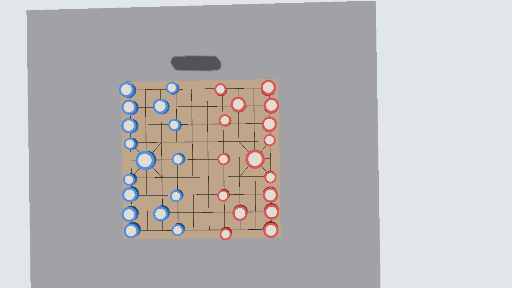

# 보정 데이터로 배치한 Gazebo 장면

로봇의 `base_link`를 Gazebo world 원점으로 사용한다. 판과 카메라는
`src/janggi/calibration/config/calibration.yaml`에서 읽으며, 외곽 크기 등 표시용 설정은
`src/janggi/robot_game/config/scene.yaml`에 분리했다.

## 400×400mm 판이 타당한가?

사용자가 알려준 **정사각형 400×400mm**를 적용했다. 검은 선의 크기는 보정된 네 교차점으로
계산하면 위/아래 356.34/359.09mm, 왼쪽/오른쪽 354.61/354.58mm다.
400mm 외곽에 넣으면 약 20~23mm의 가장자리 여백이 생기므로 기하학적으로 타당하다.
다만 이것은 **실측 확인이 아닌, 보정 격자와 모순되지 않는 추정값**이다.
나중에 외곽을 실측하면 `board.outer_size_mm`만 바꾸면 된다. 격자는 외곽 크기에 맞춰 늘리지 않는다.

| 항목 | 반영한 값 / 근거 |
|---|---|
| 판 중심, base 기준 | (465.686, 59.402, −79.607)mm |
| 판 로컬 X축 | 검은 선 TL→TR, BL→BR 방향의 평균 |
| 판 자세 RPY | (0.979638°, −0.002277°, −90.000482°) |
| 판 법선 | 네 교차점의 최적 평면으로 계산, 약 0.98° 기울기 유지 |
| 검은 선 | 네 보정 교차점 사이를 쌍선형 보간, 3D 끝점 유지 |
| 나무판 외곽 | 400×400mm, 사용자 추정값 |
| 나무판 두께 | 8mm, 표시용 가정. 윗면이 보정 평면에 놓이도록 아래로 생성 |
| RGB 광학 중심, base 기준 | (613.455, 88.593, 575.542)mm |
| 카메라 자세 | 저장된 `T_base_camera` 회전행렬 적용 |
| 영상 크기 | 1280×720 |
| 내부 파라미터 | fx=647.469788, fy=646.709167, cx=643.897827, cy=366.739136 |

RPY는 roll·pitch·yaw, 즉 X·Y·Z축 회전각이다. 판 로컬 +Y는 행 번호가 증가하는 방향의 반대다.
따라서 yaw −90°는 이 문서의 판 로컬 축 정의에 따른 값이다. 보정의 잔차가 있으므로
실물과의 무오차 일치를 보장하는 값으로 해석하지 않는다.

## D455f 모델과 좌표계

D455f 외형은 124×29×26.8mm 크기의 단순화한 모델로 만들었다.
RGB와 좌우 IR 렌즈 위치는 공식 D455 URDF의 명목 오프셋을 참고했다.
외형의 중심과 보정에 사용한 **RGB 광학 중심**은 서로 다르다.
이 장면은 광학 중심을 보정 위치에 놓고, 외형을 그에 맞춰 옮긴다.

ROS optical 좌표는 +X 오른쪽, +Y 아래, +Z 전방이다. Gazebo 카메라는 +X 전방,
+Y 왼쪽, +Z 위쪽이므로 축을 변환한 뒤 보정 회전을 적용한다.
`base_link → sim_d455f_color_optical_frame` 정적 TF도 함께 발행한다.
TF는 좌표계 사이 위치·회전을 전달하는 ROS 기능이다.

```text
calibration.yaml ── 보정 외부 파라미터 ──┬── 판 / 격자 3D 위치
                                     └── RGB optical pose + 정적 TF
                  카메라 내부 파라미터 ──── RGB-D 투영행렬
scene.yaml ── 외곽 치수 / 외형 / 주기 ────── SDF 모델

Gazebo Sensors(ogre2) → RGB / depth / CameraInfo → ros_gz_bridge → ROS 토픽
```

## 실행과 영상 확인

기존 시뮬레이션 UI와 Gazebo/가상 드라이버를 종료하고 다음과 같이 다시 시작한다.
Sensors 플러그인이 있는 새 world를 읽어야 하므로 기존 Gazebo에 UI만 재실행해서는 부족하다.
각 터미널에서 ROS와 workspace 환경이 설정되어 있어야 한다.

```bash
cd ~/doosan_janggi_ws
source /opt/ros/jazzy/setup.bash
source install/setup.bash

# 터미널 1: 가상 드라이버 + Gazebo + 카메라 브리지 + 정적 TF
ros2 launch src/janggi/robot_game/sim_gazebo.launch.py

# 터미널 2: 위와 같은 환경 설정 후, 판·말·로봇 미러·카메라 생성 및 대기
./src/janggi/robot_game/run_sim_app.sh --gazebo --setup-only

# 터미널 3: 설치되어 있다면 이미지 뷰어 실행 후 아래 RGB 토픽 선택
ros2 run rqt_image_view rqt_image_view
```

`--setup-only`는 자동 착수·홈 이동·그리퍼 명령을 보내지 않는다.
로봇 모델은 가상 드라이버의 현재 joint_states를 순기구학으로 재현한다.
물리 시뮬레이션으로 로봇이나 말을 움직이는 구성은 아니다.

| ROS 토픽 | 내용 |
|---|---|
| `/janggi_sim/d455f/color/image_raw` | 렌더링된 RGB 영상 |
| `/janggi_sim/d455f/aligned_depth_to_color/image_raw` | RGB와 같은 투영을 사용하는 이상적 깊이, m 단위 32FC1 |
| `/janggi_sim/d455f/color/camera_info` | 내부 파라미터와 optical frame |

카메라는 두 번째 터미널의 장면 생성 시 나타난다. `camera_bridge:=false`는 ROS 브리지와
정적 TF를 끄며, Gazebo 센서 자체를 끄는 옵션은 아니다.

## 실제 확인한 영상과 구현 범위



사용자 로봇과 분리한 Gazebo 서버에서 실제 렌더링한 캡처다. 검은 선과 말이 카메라 시야에 들어온다.
검증 장면에는 로봇을 생성하지 않았다. 말 외형은 기존 원기둥 모델이므로 실제 말의 글자나 실측 지름은 재현하지 않는다.

관련 자동 테스트 24개와 세 SDF(판·카메라·world)의 스키마 검증을 통과했다.
격리된 ROS 도메인에서 위 세 ROS 토픽을 실제 수신했으며 모두 1280×720이고,
프레임 이름이 `sim_d455f_color_optical_frame`인 것을 확인했다.
렌더링 깊이의 주점 픽셀은 약 0.653m였다.
수치 기록은 [layout_and_validation.json](analysis/gazebo_calibrated_scene/layout_and_validation.json),
센서 내부 파라미터 수신 기록은 [camera_info.json](analysis/gazebo_calibrated_scene/camera_info.json)에 있다.

RGB-D는 이상적인 핀홀 모델이다. 저장된 `inverse_brown_conrady` 계수를 정방향 Brown 왜곡으로
잘못 적용하지 않도록 왜곡은 넣지 않았다. 따라서 실제 원본 영상의 렌즈 왜곡까지 동일하게 재현하는 것은 아니다.
스테레오 매칭, IR 투사, 하드웨어 필터, 노이즈, IMU도 구현 범위에 포함하지 않는다.
기존 대국 UI의 입력은 계속 `SimWorld`의 정답 위치를 투영한 가짜 검출이며,
이번 RGB 영상을 YOLO/CNN 입력으로 연결하는 변경은 하지 않았다.

검증 환경에서는 Mesa의 강제 소프트웨어 EGL 초기화가 충돌했다. 검증 프로세스에만
Xvfb와 Mesa llvmpipe를 적용하고 `LIBGL_ALWAYS_SOFTWARE`를 해제하여 영상을 확인했다.
이 우회 설정은 일반 실행 코드에 강제하지 않는다.

## 근거

- 내부 파일: `src/janggi/calibration/config/calibration.yaml` (실제 보정 좌표·카메라 내부 파라미터)
- [Intel D455f 사양](https://www.intel.fr/content/www/fr/fr/products/sku/233193/intel-realsense-depth-camera-d455f/specifications.html) (외형 크기)
- [공식 D455 URDF](https://raw.githubusercontent.com/realsenseai/realsense-ros/ros2-master/realsense2_description/urdf/_d455.urdf.xacro) (명목 외형/광학 프레임 오프셋)
- [RealSense D400 데이터시트, 2025-08](https://realsenseai.com/wp-content/uploads/2025/08/Intel-RealSense-D400-Series-Datasheet-August-2025.pdf)

