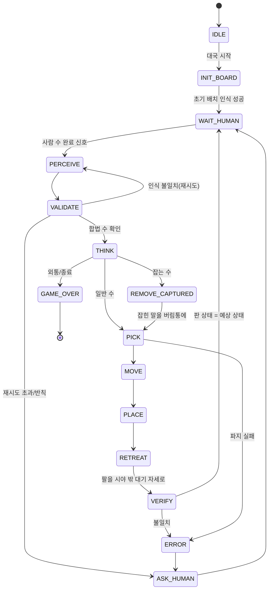

# 장기 대국 로봇 설계

카메라로 장기판과 말을 인식하고, 장기 엔진이 고른 수를 Doosan E0509 + RH-P12-RN-A 그리퍼로 직접 두는 시스템의 설계 문서다. 팔/그리퍼 제어 계층은 [ARCHITECTURE.md](ARCHITECTURE.md)를 따르며, 이 문서는 그 위에 올라가는 애플리케이션 계층을 다룬다.

> 상태: 초안. `미정`으로 표시한 항목은 구현 전에 결정한다.

## 1. 목표와 범위

- 사람(초)과 로봇(한)이 실제 장기판에서 한 판을 끝까지 둔다.
- 로봇은 항상 후공이다. 장기 규칙상 초가 먼저 두므로 로봇은 **한(붉은 말)** 을 잡는다.
- 사람이 수를 두면 로봇이 판을 인식해 상대 수를 파악하고, 엔진이 고른 최선수를 말 집기 → 이동 → 착수로 실행한다.

범위 밖(1차): 사람의 반칙 수 처리 자동화, 무르기, 빅장/점수 판정 UI, 여러 판 연속 대국.

## 2. 장비

| 구분 | 장비 | 비고 |
|---|---|---|
| 로봇팔 | Doosan E0509 | 세팅 완료, `/dsr01/motion/*` 서비스 사용 |
| 그리퍼 | ROBOTIS RH-P12-RN-A | 세팅 완료, `/dsr01/gripper/*` 서비스 사용 |
| 카메라 | Intel RealSense D455 | RGB + Depth, ROS 드라이버 `realsense2_camera` |

카메라 장착 방식(고정형 eye-to-hand / 손목 장착 eye-in-hand)은 `미정`이다. 이 문서는 **판 전체를 위에서 내려다보는 고정형**을 기본으로 가정한다. 판 전체를 한 프레임에 보면서 팔이 시야를 가리지 않을 때만 인식하면 되기 때문이다.

## 3. 시스템 구성

```text
RealSense D455
  │  /camera/color/image_raw, /camera/aligned_depth_to_color/image_raw, camera_info
  ▼
[perception]  YOLO 판 인식 + YOLO 말 인식
  │  Detections (bbox, class, score)
  ▼
[board_state]  격자 매핑 → 10×9 보드 배열 / FEN
  │  BoardState
  ▼
[game_manager]  턴 관리, 사람 수 추출·검증, 대국 종료 판정
  │  FEN  ──▶  [engine]  장기 엔진 (UCI)  ──▶  최선수 Move
  ▼
[executor]  FSM: (잡기 제거) → 집기 → 이동 → 착수 → 확인
  │  ▲
  │  └── [localization]  bbox + depth → base 좌표계 3D 점
  ▼
/dsr01/motion/move_line, move_joint …   /dsr01/gripper/open, close, position_cmd
```

### 3.1 모듈별 책임

| 모듈 | 입력 | 출력 | 비고 |
|---|---|---|---|
| perception | color 이미지 | 판/말 detection | Roboflow에서 학습한 YOLO 가중치로 로컬 추론 |
| board_state | detection, depth | `BoardState` (10×9 배열, FEN) | 판 detection으로 격자 좌표 계산 후 말 중심을 가장 가까운 교차점에 할당 |
| game_manager | 직전/현재 `BoardState` | 사람의 수, 엔진 요청 | 두 상태의 차이로 수를 추출하고 규칙상 합법인지 검증 |
| engine | FEN | 최선수(UCI 표기) | 후보: Fairy-Stockfish(`janggi` variant 지원) — `미정` |
| localization | bbox, depth, 내부/외부 파라미터 | base 좌표계 (x, y, z) | 4장 참고 |
| executor | 최선수, 출발/도착 좌표 | 로봇 동작 | FSM, 5장 참고 |

### 3.2 패키지 배치

```text
src/janggi/
├── janggi_interfaces/   msg/srv 정의 (ament_cmake)
├── janggi_perception/   YOLO 추론 노드, board_state
├── janggi_game/         game_manager, 엔진 래퍼
├── janggi_executor/     FSM, localization
└── janggi_bringup/      전체 launch, 파라미터(yaml)
```

규칙·보드 변환·좌표 계산 같은 핵심 로직은 ROS에 의존하지 않는 순수 Python 모듈로 작성하고, 노드는 그것을 감싸는 얇은 계층으로 둔다. 로봇 없이 pytest로 검증하기 위해서다.

학습 코드와 데이터셋은 colcon 대상이 아니므로 `src/` 밖에 두고, 모델 가중치는 git에 직접 넣지 않는다(`models/`, `.gitignore` 또는 Git LFS — `미정`).

## 4. 인식

### 4.1 학습 데이터 (Roboflow)

두 개의 모델을 따로 학습한다.

**말 인식 모델** — 14 클래스

| 한(로봇) | 초(사람) |
|---|---|
| `han_king` 궁 | `cho_king` 궁 |
| `han_chariot` 차 | `cho_chariot` 차 |
| `han_cannon` 포 | `cho_cannon` 포 |
| `han_horse` 마 | `cho_horse` 마 |
| `han_elephant` 상 | `cho_elephant` 상 |
| `han_guard` 사 | `cho_guard` 사 |
| `han_soldier` 병 | `cho_soldier` 졸 |

**판 인식 모델** — 판 영역과 격자 기준점

판 bbox만으로는 격자 위치가 정확하지 않으므로, 네 모서리(또는 궁성 꼭짓점 등) keypoint를 함께 검출하는 방식을 권장한다. keypoint 4개로 이미지 → 판 평면 homography를 구하면 90개 교차점의 픽셀 좌표를 계산할 수 있다. 방식(bbox / keypoint / segmentation)은 `미정`이다.

데이터 수집 시 실제 대국 환경(조명, 카메라 높이·각도, 손/팔이 일부 가리는 장면)을 포함한다. Roboflow에서 YOLO 형식으로 export해 로컬에서 학습하고, 추론도 로컬(GPU)에서 한다. 대국 중 네트워크 지연과 외부 의존을 피하기 위해서다.

### 4.2 보드 상태 변환

1. 판 검출 → homography → 교차점 90개의 픽셀 좌표 `grid[r][c]` (r: 0–9 행, c: 0–8 열).
2. 말 검출마다 bbox 중심을 가장 가까운 교차점에 할당한다. 거리가 임계값을 넘으면 버린다.
3. 한 교차점에 여러 검출이 겹치면 score가 높은 것만 남긴다.
4. 결과를 10×9 배열과 FEN 문자열로 만든다.
5. 단일 프레임 오검출을 줄이기 위해 연속 N 프레임의 결과가 같을 때만 확정한다.

### 4.3 상대 수 추출

직전 확정 상태와 현재 확정 상태를 비교한다.

- 정상 수: 한 칸이 비고(출발), 한 칸이 새로 채워지거나 말 종류가 바뀜(도착, 잡기 포함).
- 한수쉼: 차이 없음 + 사람이 명시적으로 알림.
- 그 외(두 칸 이상 변화, 규칙상 불가능한 수): 인식 오류 또는 반칙으로 보고 재인식 → 계속 실패하면 사람에게 확인을 요청한다.

사람이 수를 끝냈다는 신호는 1차 구현에서 **수동 트리거**(ROS 서비스 호출 또는 키 입력)로 받는다. 손이 판에서 사라지고 상태가 일정 시간 안정되면 자동 감지하는 방식은 이후 과제다.

### 4.4 초기 배치

장기는 마·상 위치를 네 가지로 바꿔 놓을 수 있다(상마상마, 마상마상 등). 대국 시작 시 판을 인식해 실제 배치를 읽고, 그 배치를 엔진에 시작 FEN으로 넘긴다.

## 5. 위치 추정 (localization)

엔진이 고른 수를 실제 좌표로 바꾸는 단계다.

### 5.1 집기 좌표: 말 bbox + depth

1. color에 정렬된 depth(`aligned_depth_to_color`)에서 말 bbox 영역을 잘라낸다. 가장자리 혼입을 줄이기 위해 bbox를 중심 기준 일정 비율로 축소한다.
2. depth 0(무효)과 이상치(판 평면보다 먼 점, 통계적 outlier)를 제거한다.
3. 남은 픽셀마다 내부 파라미터로 카메라 좌표 3D 점을 구한다.
   `X = (u - cx)·Z / fx`, `Y = (v - cy)·Z / fy`, `Z = depth`
4. 점들의 **중앙값**을 말 윗면 중심으로 삼는다. 평균보다 가장자리 노이즈에 강하다.
5. 외부 파라미터 `T_base_camera`로 로봇 base 좌표계로 변환한다.
6. 집기 높이 = 윗면 z − (그리퍼 파지 깊이 오프셋). 접근은 위에서 수직으로 한다.

### 5.2 놓기 좌표: 판 교차점

도착 칸에는 말이 없으므로 bbox가 없다. 판 인식에서 얻은 교차점 픽셀 좌표 `grid[r][c]`와 판 평면 depth로 3D 점을 구한다. 교차점 한 점의 depth는 노이즈가 크므로, 판 영역 depth 점들로 **평면을 피팅**하고 교차점 광선과 평면의 교점을 사용한다.

같은 방식으로 판 평면에서 교차점 90개의 base 좌표를 대국 시작 시 한 번 계산해 캐시하고, 집기 좌표 검증(“집으려는 말이 정말 그 칸에 있는가”)에도 쓴다.

### 5.3 좌표계와 파라미터

| 프레임 | 설명 |
|---|---|
| `base_link` | 로봇 기준. 모든 목표 좌표는 여기로 변환한다 |
| `camera_color_optical_frame` | RealSense color 광학 좌표계 |
| `board` | 판 좌하단 교차점 원점, 판 평면이 XY (선택) |

- **내부 파라미터**: RealSense가 `camera_info`로 제공하는 공장 값을 우선 사용하고, 정확도가 부족하면 별도 보정한다 — `추후 설정`.
- **외부 파라미터** `T_base_camera`: hand-eye 보정으로 구한다 — `추후 설정`. yaml 파라미터로 두고 static TF로 퍼블리시한다.

## 6. 실행 FSM (executor)



| 상태 | 동작 |
|---|---|
| PICK | 출발 칸 위 접근 높이로 이동 → 그리퍼 열기 → 수직 하강 → 닫기 → 상승. 그리퍼 stroke로 파지 성공 여부 확인 |
| MOVE | 안전 높이를 유지한 채 도착 칸 위로 이동 |
| PLACE | 수직 하강 → 열기 → 상승 |
| REMOVE_CAPTURED | 도착 칸의 상대 말을 먼저 집어 판 밖 지정 위치에 놓음 |
| RETREAT | 카메라 시야를 가리지 않는 대기 자세(joint 고정값)로 복귀 |
| VERIFY | 재인식해 실제 판이 엔진 수 적용 후 상태와 같은지 확인 |

각 상태는 타임아웃과 실패 결과를 가지며, 로봇 서비스 호출 실패는 모두 ERROR로 모은다. FSM 구현 방식(직접 구현 / SMACH / BehaviorTree)은 `미정`이다.

## 7. 인터페이스 (초안)

```text
# janggi_interfaces/msg/PieceDetection.msg
string  class_name
float32 score
int32[4] bbox            # x1 y1 x2 y2 (pixel)

# janggi_interfaces/msg/BoardState.msg
std_msgs/Header header
string fen
string[90] cells         # row-major, 빈 칸은 ""
bool stable              # N 프레임 연속 일치 여부

# janggi_interfaces/msg/JanggiMove.msg
int8 from_row
int8 from_col
int8 to_row
int8 to_col
string piece
string captured          # 없으면 ""
bool is_pass             # 한수쉼

# janggi_interfaces/srv/ExecuteMove.srv
JanggiMove move
---
bool success
string message
```

## 8. 안전

- 모든 목표 좌표는 판 영역 + 여유 범위의 작업 공간 경계와 최소 z를 넘지 않는지 검사한 뒤 실행한다.
- 대국 중 속도/가속도는 낮은 값으로 제한한다.
- 사람이 판에 손을 대고 있는 동안에는 로봇이 움직이지 않는다(1차: 수동 트리거로 보장).
- 새 동작은 가상 모드에서 먼저 확인한다. 단, 가상 모드에서 그리퍼 통신은 실패하는 것이 정상이므로 그리퍼 로직은 mock으로 대체한다.

## 9. 미정 사항

| 항목 | 선택지 |
|---|---|
| 카메라 장착 | 고정형(기본 가정) / 손목 장착 |
| 판 인식 방식 | bbox / keypoint / segmentation |
| 장기 엔진 | Fairy-Stockfish / 자체 구현 / 기타 |
| FSM 구현 | 직접 구현 / SMACH / BehaviorTree.CPP |
| 사람 수 완료 신호 | 수동 트리거(1차) → 자동 감지 |
| 모델 가중치 관리 | `.gitignore` + 공유 드라이브 / Git LFS |
| 내부·외부 파라미터 | 보정 절차 별도 문서화 예정 |

## 10. 개발 순서 (제안)

1. RealSense 드라이버 연동, color/depth 정렬 토픽 확인
2. Roboflow 데이터 수집·라벨링, 말/판 YOLO 학습
3. 보드 상태 변환 + 상대 수 추출 (녹화 이미지로 오프라인 검증)
4. 엔진 연동: FEN 입력 → 최선수
5. hand-eye 보정, localization 정확도 측정
6. 단일 동작(집기·놓기) 실기 검증
7. FSM 통합, 한 판 대국
