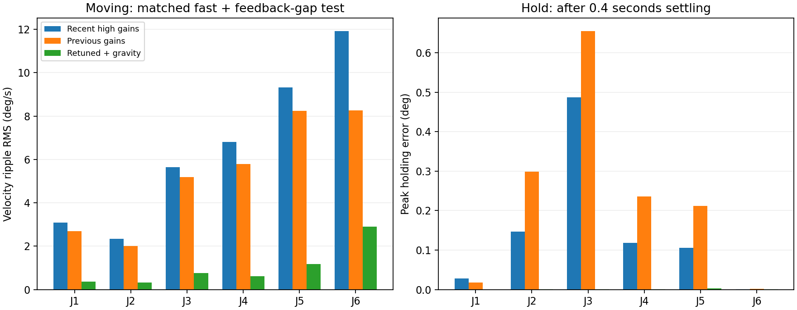

# Gazebo 팔 제어기 재튜닝 — 2026-11-13

> 최신 적용값과 파지·타이밍 검증은 [2026-11-14 물리 파지 수정](../physical_grasp_20261114/README.md)을 따른다. 아래 내용은 이전 비교·복원 이력이다.

## 직전 복원 이력 — 2026-11-14

사용자 확인 후 한 단계 더 이전의 `sweep.py` 비교 프로파일 `previous`로 팔 PID만 복원했다.
그리퍼 PID·개도 환산, 목표 보간, 질량·충돌·토크 한도는 유지했다.

| 축 | P | I | D |
|---|---:|---:|---:|
| J1 | 1200 | 100 | 40 |
| J2 | 1800 | 600 | 60 |
| J3 | 1500 | 600 | 40 |
| J4 | 500 | 100 | 8 |
| J5 | 300 | 100 | 4 |
| J6 | 120 | 100 | 0.8 |

Gazebo 재시작 후 적용된다. 아래 내용은 앞선 변경·시험 이력이다.

> 2026-11-14: 사용자 요청으로 이 재튜닝 적용을 철회했다. 현재 팔은
> [직전 PID 설정](../arm_smoothing/README.md)의 축별 P/I/D로 복원했다.
> 위치 PI·속도 P·중력 피드포워드 플러그인은 생성하지 않는다.
> 아래 시험 결과와 게인 표는 재튜닝 당시의 비교 이력이다.
> 현재의 목표 보간, 그리퍼 개도 환산과 그리퍼 PID는 유지했다.

## 결과와 적용 범위

**실제 로봇 제어는 변경하지 않았다.** `PhysicsRobot`이 생성하는 Gazebo 모델의 팔 6축에만 적용한다.
DRFL, 두산 실제 제어기, PickPlace2 이동 명령과 속도 설정, 실제 그리퍼 시리얼 명령은 이번 작업에서 변경하지 않았다.
기존의 그리퍼 700 → 1.0rad 환산과 손가락 mimic 제약도 유지했다.

이전의 높은 P/I 게인은 좁은 시험에서는 위치 오차를 줄였지만, 여러 자세·큰 이동에서는 속도 잔진동을 키웠다.
사용자가 느낀 악화를 다중 자세 시험에서도 확인했다. 이번에는 단순히 게인만 올리는 접근을 철회했다.

팔 제어를 Gazebo 기본 `JointTrajectoryController`의 **위치 PI + 속도 오차 P + 중력 피드포워드**로 바꿨다.
별도 C++ 제어 플러그인을 만들지 않고 설치된 Gazebo 시스템을 사용한다.
중력 피드포워드는 URDF 질량·무게중심에서 중력 지지 토크를 미리 계산하는 기능이다.
중력 부하를 큰 적분 게인으로 버티지 않아도 되므로 낮은 게인으로 정지 오차를 줄일 수 있다.



## PID는 매니퓰레이터에 적합한가?

관절 서보에 P/PD/PID 계열 피드백을 쓰는 것은 일반적이다. 여기에 속도·가속도 피드포워드,
중력 보상, 관절 임피던스 제어 등을 조합한다. 임피던스는 위치 오차에 대한 가상 스프링과 속도에 대한 감쇠를 정하는 방식이다.
특정 고급 제어기로 이름을 바꾸는 것만으로 물리 모델·목표 갱신 문제를 해결할 수 있는 것은 아니다.

- [UR 공식 ServoJ 설명](https://www.universal-robots.com/articles/ur/programming/servoj-command/): gain을 P 항에 비유하며, 높은 gain과 낮거나 불규칙한 목표 갱신률이 진동을 일으킬 수 있다고 설명한다.
- [Franka 공식 관절 임피던스 예제](https://github.com/frankarobotics/libfranka/blob/main/examples/joint_impedance_control.cpp): 관절 위치·속도 오차 기반 토크 제어 예시다.
- [Gazebo JointTrajectoryController API](https://gazebosim.org/api/sim/8/classgz_1_1sim_1_1systems_1_1JointTrajectoryController.html): 위치/속도 PID와 궤적 effort 피드포워드를 지원한다.
- [Gazebo 실제 구현](https://github.com/gazebosim/gz-sim/blob/gz-sim8/src/systems/joint_traj_control/JointTrajectoryController.cc): 위치·속도 피드백 출력과 effort를 합쳐 물리 엔진의 관절 힘 명령으로 전달한다.

이번 제어기는 다음 형태다. 위치 오차를 미분하는 D 항은 0으로 설정하고, 실제 속도 오차를 별도로 사용한다.

```text
e = q_ref − q_actual
τ = clamp(Kp·e + Ki·∫e, position_budget)
  + clamp(Kv·(v_ref − v_actual), velocity_budget)
  + clamp(g(q_ref), gravity_budget)
```

이 방식은 PD/PID 계열의 확장이며 두산의 비공개 실물 모터 제어기를 복제한 것이 아니다.
관성·코리올리 전체를 보상하는 computed torque 제어도 아니다. 접촉을 없애거나 관절 위치를 강제로 지정하지 않는다.

## 현재 게인과 목표 전달

설정 위치: `src/janggi/robot_game/physics_robot.py`의 `ARM_GAINS`.
마지막 열은 **위치 D가 아닌 속도 오차의 P 게인**이다. 각도 rad, 시간 s, 토크 Nm를 사용한다.

| 축 | 위치 Kp (Nm/rad) | 위치 Ki (Nm/(rad·s)) | 속도 Kv (Nm·s/rad) |
|---|---:|---:|---:|
| J1 | 1000 | 10 | 40 |
| J2 | 1500 | 20 | 45 |
| J3 | 1200 | 20 | 30 |
| J4 | 350 | 10 | 6 |
| J5 | 250 | 10 | 4.5 |
| J6 | 120 | 10 | 1.4 |

- 위치 D=0, 속도 I/D=0. 손가락의 기존 PID는 유지한다.
- 팔 토크 예산은 기존 URDF 한도 J1~3 194Nm, J4~6 66Nm를 초과하지 않는다.
  위치 출력 50%, 속도 출력 15%, 중력 출력 35%로 분배해 최악의 합계도 한도 이하다.
  이 값은 현재 URDF 예산이며 제조사가 공개한 피크 모터 토크라고 주장하지 않는다.
- 50Hz 관절 위치·속도를 35ms 지연 버퍼에 넣고 단조 3차 Hermite 보간으로 명목 200Hz 전달한다.
  보간은 기록된 두 점 사이에서만 수행하며 위치를 외삽하지 않는다. 극단적인 접선은 제한한다.
- 소스가 끊기면 마지막 위치와 속도 0을 유지한다. 복구 시 기록된 경로를 최대 1.05배 시간 진행률로
  재생해 목표가 갑자기 앞으로 튀지 않게 한다. 반복 단절 시 표시 로봇이 에뮬레이터보다 늦어질 수 있다.
  이번 단절 시험은 100ms이며 장시간 통신 장애 전체를 검증한 것은 아니다.
- 그리퍼 목표는 기존 최신 stroke를 그대로 사용한다.
- 중력 계산은 고정 장착부와 그리퍼 질량을 포함한다. 손가락은 명령 각도를 사용하며,
  집은 말의 추가 하중이나 실제 접촉 토크를 자동 추정하지 않는다.

## 시험 A: 이전·높은·후보 게인의 동일 조건 비교

`recovered_stress.json`, `ripple_metrics.json` 및 압축 CSV에 결과를 저장했다.
별도 `GZ_PARTITION`의 headless Bullet Featherstone, 물리 1ms, 로봇 4대의 충돌 그룹을 분리했다.
실제 ROS 서비스나 에뮬레이터에 이동 명령을 보내지 않았다.

- 기본 홈: `[0, −13.694, 134.216, 0, 59.485, 90]°`.
- 각 축 양방향 이동 후 홈 복귀: J1 ±40°, J2 ±12°, J3 +12/−18°, J4 ±35°, J5 ±20°, J6 ±70°.
- 고정 자세의 XY 60mm·Z 80mm 끝점 이동 및 측정 도구 홈 `[0,0,90,0,90,0]°` 왕복.
  시험 A는 **끝점 IK를 관절 공간에서 연결**했다. 직선 Cartesian 경로는 시험 B에서 따로 검증했다.
- 이동 시간을 기본 대비 25% 줄인 빠른 조건. 약 3.7초마다 100ms 목표 입력 중단.
- 약 71초의 시뮬레이션을 프로파일별 동시에 비교. 정지 명령 후 첫 0.4초는 settling 구간으로 분리.
- 속도 잔진동 지표: 1kHz 실제 관절 속도에서 101ms/3차 Savitzky–Golay 추세를 뺀 잔차의 이동 구간 RMS.
  특정 고유진동 주파수나 물리적 진동량 전체를 뜻하는 지표는 아니다.

| 축 | 최근 높은 게인 속도 잔차 RMS (°/s) | 예전 게인 | 최종 설정 | 최근 높은 게인 대비 감소 |
|---|---:|---:|---:|---:|
| J1 | 3.089 | 2.694 | 0.362 | 88% |
| J2 | 2.336 | 2.017 | 0.323 | 86% |
| J3 | 5.636 | 5.191 | 0.757 | 87% |
| J4 | 6.801 | 5.789 | 0.626 | 91% |
| J5 | 9.319 | 8.238 | 1.187 | 87% |
| J6 | 11.924 | 8.268 | 2.899 | 76% |

전 관절 정지 구간 최대 위치 오차: 최근 높은 게인 약 0.487°, 예전 약 0.655°, 최종 약 0.00353°.
최종 설정의 이동 중 최대 오차는 약 1.165°였다. 낮은 정지 오차가 이동 내내 같은 정확도를 의미하지 않는다.
추가 감쇠 후보는 약간의 추종 오차 증가와 교환해 손목 속도 잔차를 더 줄여 최종 설정으로 선택했다.

## 시험 B: 최종 코드·판·말 포함 직접 검증

`validate_production.py`는 최종 `physical_robot_sdf`, `PhysicsRobot._on_js`, `sync`, `GravityModel`을 그대로 사용한다.
합성 목표를 메모리로 넣어 ROS 연결 없이 검증한다. 판·받침·32개 동적 말이 있는 별도 headless Gazebo를 사용했다.
장착 오프셋은 사용자의 최근 실행값인 0mm로 시험했다.

- 약 48.83초, 실제 물리 피드백 48,829개 저장: `production.json`, `production.csv.gz`.
- 실제 직선 Cartesian 위치 궤적을 오프라인 IK로 생성하고 플랜지 자세를 유지했다.
- 홈 → 판 접근 → X 250mm → Y 260mm → XY 복귀 → Z 35mm 하강·상승 → 홈 → 도구 홈 → 홈.
- 직선 이동의 목표 최대 속도 약 120mm/s, 가감속에는 5차 궤적 사용.
- 판 주변 시험 플랜지 범위: X 340~590mm, Y −80~180mm, Z 170~205mm.
  이 범위의 시험 경로가 안정적이었다는 의미이며, 공간 내 모든 자세나 속도를 보장하는 인증 범위는 아니다.
- 모든 정지 구간의 최대 오차 약 **0.00262°**, 정지 구간 각도 최대 흔들림 약 **0.00096°**.
- 판 주변 직선 이동의 관절 최대 추종 오차 약 **0.252°**. 초기 홈 이동까지 포함하면 약 **1.105°**.
- Gazebo 오류 로그 없음. 이 시험은 공중 이동·정지 시험이며 물리적 집기 성공률·강한 접촉 안정성은 별도 과제다.

단위 테스트는 로봇 게임·PickPlace2 합계 **142개 통과**했다. 중력 토크의 부호·단위는 서로 다른 세 자세에서
중력 위치 에너지의 수치 미분과 비교했으며 오차 1e−5Nm 이내를 확인했다.

## 다시 적용·시험하기

Gazebo를 종료하고 기존 실행 명령으로 다시 시작하면 새 제어기가 생성된다. Python 변경이므로 colcon 재빌드는 필요 없다.
기존 Gazebo에 이미 생성된 모델의 플러그인 값은 실행 중인 파일만 고쳐서는 바뀌지 않는다.

```bash
cd ~/doosan_janggi_ws
source /opt/ros/jazzy/setup.bash
source install/setup.bash
ros2 launch src/janggi/robot_game/sim_gazebo.launch.py \
  gripper_mount_offset_mm:=0
```

진단 재현 명령(전부 별도 Gazebo 파티션, 실제 로봇 명령 없음):

```bash
/usr/bin/python3 docs/analysis/arm_retuning/sweep.py \
  --trajectory --cubic --source-velocity --fast --source-jitter --final \
  --continuous --label recovered_stress
/usr/bin/python3 docs/analysis/arm_retuning/validate_production.py
/usr/bin/python3 docs/analysis/arm_retuning/analyze.py
python3 -m pytest -q src/janggi/robot_game/tests src/janggi_pick_place2/tests
```

이전 실험의 요약 JSON은 비교 이력으로 보관했다. 중간 실험의 대용량 CSV는 정리하고 최종 비교 4개와
최종 코드 검증 CSV만 보관했다. 현재 수치가 실물 E0509 내부 제어기와 같다는 뜻은 아니다.
