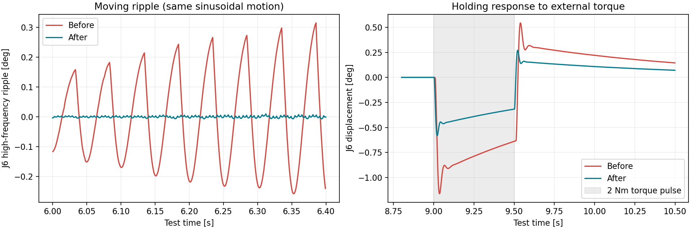

# 팔 잔진동 추가 개선 및 그리퍼 닫힘 환산 복원

> 최신 적용값은 [2026-11-14 물리 파지·제어 수정](../physical_grasp_20261114/README.md)을 따른다. 아래 게인은 비교 이력이다.

> 2026-11-14 아래 표로 복원한 뒤, 사용자 요청으로 한 단계 더 이전의 `previous` 게인으로 다시 복원했다.
> 현재 값은 [게인 변경 기록](../arm_retuning/README.md)의 첫 표를 따른다. 아래 표는 당시 이력이다.
> 후속 [재튜닝 시험](../arm_retuning/README.md)은 비교 이력으로 보관한다.
> 목표 전달 버퍼는 현재의 35ms/3차 보간을 유지하며, 아래 25ms/선형 보간 설명은 당시 기록이다.

## 적용 범위

사용자가 말한 700 미폐쇄는 실제 장치에 대한 질문이었다. 앞선 시뮬레이션 폐쇄각 확대는
실제 장치 이상을 진단한 결과가 아니므로 철회했다.

- C++/Python 퍼블리셔 모두 **700 → 1.0rad**로 복원.
- 그리퍼 관절 상한은 원래 **1.101rad**로 복원.
- 물리 장치에 보내는 명령 0~700과 시리얼 제어는 그대로다.
- 관성·질량·native mimic 개선은 유지한다. stroke 진행 속도도 현재 8단위/20ms로 유지한다.
- 빌드된 퍼블리셔를 별도 ROS 도메인 213에서 실행해 700 → 1.0rad를 확인했다.
  `../gazebo_dynamics_fix/publisher_check.json` 참고.

실물 그리퍼가 700에서 덜 닫히는 원인은 아직 이 시험으로 확인하지 않았다.
이번 작업에서 실제 로봇이나 그리퍼에 명령을 보내지 않았다.

## 실물 제어기와 같은 PID인가?

같다고 확인할 수 없다. 공식 ROS2 설명에서 `dsr_controller2`는 `movej/movel` 등을
DRFL에 전달하고 실제 두산 제어기가 움직임을 처리한다. 공개 문서와 현재 드라이버/API
헤더에서는 E0509 실물의 축별 내부 P/I/D 숫자를 확인하지 못했다.
Gazebo의 게인은 별도로 구성한 시뮬레이션 값이며 제조사 정격 게인이라고 표시하지 않는다.
실제 제어기 전체 동작을 단일 Gazebo 토크 PID로 그대로 재현한 것도 아니다.

- [두산 공식 ROS2 구조](https://doosanrobotics.github.io/doosan-robotics-ros-manual/jazzy/overview/architecture.html)
- [두산 real/virtual 제어 경로](https://doosanrobotics.github.io/doosan-robotics-ros-manual/jazzy/tutorials/operation_modes.html)
- [Gazebo force PID 구현](https://github.com/gazebosim/gz-sim/blob/gz-sim8/src/systems/joint_position_controller/JointPositionController.cc)

## 최소 변경으로 개선한 부분

기존에는 50Hz 관절 피드백을 장면 루프가 **20Hz**로 샘플링해 계단식 목표로 보냈다.
Gazebo PID가 이 위치 오차를 미분하므로 목표값 갱신 때마다 충격성 응답이 생길 수 있다.

1. 원본 피드백을 25ms 지연 버퍼에 저장하고 선형 보간한다.
2. 팔 목표 전달은 명목 200Hz로 실행한다. 처리 시간을 제외한 남은 주기만 기다린다.
3. 원본 피드백이 끊기면 마지막 목표를 유지한다. 속도를 추정해 계속 움직이는 외삽은 하지 않는다.
4. 팔 P/I는 이전 개선값의 2배, D는 1.4배로 조정해 위치 강성을 높이고 감쇠를 보강했다.
5. 적분 출력 한도는 각 관절 토크 상한 이하로 제한했다.
6. 구동되는 팔 6축과 그리퍼 1축에만 목표를 발행한다. passive mimic 관절에 쓸모없는 명령을 보내지 않는다.

그리퍼 목표는 보간하지 않고 기존 최신 stroke를 사용한다. 팔의 토크 상한 194/66Nm,
질량·중력·충돌은 유지한다. 위치를 강제로 덮어쓰거나 물체를 순간이동시키지 않는다.
별도 네이티브 플러그인이나 제어 패키지도 추가하지 않았다.

| 관절 | P | I | D | 토크 상한 Nm |
|---|---:|---:|---:|---:|
| J1 | 2400 | 200 | 56 | 194 |
| J2 | 3600 | 1200 | 84 | 194 |
| J3 | 3000 | 1200 | 56 | 194 |
| J4 | 1000 | 200 | 11.2 | 66 |
| J5 | 600 | 200 | 5.6 | 66 |
| J6 | 240 | 200 | 1.12 | 66 |

25ms는 목표 전달 지연이다. 예를 들어 120mm/s 동작에서는 같은 시각의 에뮬레이터보다
이 지연만으로 약 3mm 뒤따를 수 있다. Gazebo와 실제 로봇의 동작이 완전히 동시·동일하다고
해석하지 않는다. 정지 후 최종 목표는 바꾸지 않고 최신 위치로 수렴한다.

## 독립 Gazebo 검증

별도 `GZ_PARTITION`의 headless Bullet Featherstone 월드, 물리 스텝 1ms에서 측정했다.
사용자의 실행 중인 Gazebo나 실제 ROS 로봇에는 연결하지 않았다.



| 지표 | 이전 개선 상태 | 이번 개선 |
|---|---:|---:|
| 이동 중 J1 잔물결 RMS | 0.04154° | 0.001365° |
| 이동 중 J2 잔물결 RMS | 0.02337° | 0.000927° |
| 이동 중 J3 잔물결 RMS | 0.01856° | 0.000474° |
| 이동 중 J4 잔물결 RMS | 0.07804° | 0.001620° |
| 이동 중 J5 잔물결 RMS | 0.03476° | 0.000728° |
| 이동 중 J6 잔물결 RMS | 0.13680° | 0.002598° |
| 외란으로 인한 J6 최대 밀림 | 1.1630° | 0.5825° |

잔물결은 같은 정현파 왕복 동작의 5.2~7.8초 구간에서 측정했다.
Gazebo 시각 기준으로 1ms 균일 재표본화한 실제 관절각에서 101점/3차 Savitzky–Golay
추세를 빼고 RMS를 구했다. **이 값은 전체 추종 오차나 절대 위치 정확도가 아니다.**
정현파 이동의 완만한 성분과 분리한 고주파 움직임의 비교다.

지지력 시험은 정지 중 세계 Z 방향 2Nm 토크를 `link_6`에 9.0~9.5초 동안 가하고 해제했다.
외력은 native ApplyLinkWrench로 적용했다. 구동 모터 토크를 무제한으로 늘린 시험이 아니다.
외란 이전 각도에서 얼마나 밀렸는지를 비교했으며 이번 조건에서는 최대 밀림이 약 절반으로 줄었다.
모든 자세·속도·충돌 조건의 진동 제거를 보장하는 실험은 아니다.

## 재현·원시 데이터

`baseline_disturb.sdf`는 이번 변경 직전 PID를 보존한 스냅샷이다.
`final_disturb.sdf`는 시험한 개선 설정이다. CSV.gz에는 wall/simulation 시각과 실제/목표/원본
관절각이 들어 있다. `compare.py`로 통계와 PNG를 재생성할 수 있다.

```bash
source /opt/ros/jazzy/setup.bash
source install/setup.bash
python3 docs/analysis/arm_smoothing/measure.py baseline_rerun --bullet --disturb \
  --model-file docs/analysis/arm_smoothing/baseline_disturb.sdf
python3 docs/analysis/arm_smoothing/measure.py improved_rerun --bullet --smooth --disturb
MPLCONFIGDIR=/tmp/janggi_mpl python3 docs/analysis/arm_smoothing/compare.py
```

단위·회귀 검사 136개 통과. 그리퍼 C++ 퍼블리셔까지 재빌드 완료. 기존 가상 bringup과 Gazebo를 종료하고 새로 실행해야
닫힘 환산·PID·보간이 모두 반영된다.
