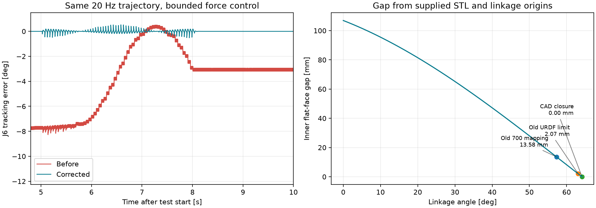

# Gazebo 흔들림·그리퍼 폐쇄 문제 조사 및 수정

> 후속 변경: 그리퍼 닫힘 환산은 사용자 요청으로 **700 → 1.0rad**, 상한 1.101rad로 복원했다.
> 1.119189rad 폐쇄각 확대는 철회한 실험이며 아래 최초 비교 그래프는 당시 기록이다.
> 현재 팔 PID·200Hz 보간·외란 시험은 [후속 개선 기록](../arm_smoothing/README.md)을 따른다.

2026-11-13. 수정 전 루트 스냅샷: `c8064a1`. 그리퍼 설명 하위 저장소 스냅샷: `451d5e8`.

실제 로봇에는 이동·그리퍼 명령을 보내지 않았다. 모든 동작 시험은 별도 `GZ_PARTITION`의
headless Gazebo에서 실행했고, 빌드된 각도 퍼블리셔 시험은 별도 ROS 도메인 213에서 실행했다.
사용자가 실행 중인 Gazebo는 재시작하거나 종료하지 않았다.

## 결론

질량이 과도하거나 로봇 모터 토크가 부족해서 생긴 현상이 주원인은 아니었다.
**공통 PID에 의한 손목 추종 불량**, **그리퍼의 부정확한 관성·각도 변환·감쇠**,
**실제 기계 연결을 제거한 네 개의 독립 손가락 제어**가 확인됐다.



| 확인 항목 | 수정 전 | 적용 결과 |
|---|---|---|
| J6 왕복 추종 오차 RMS | 4.896° | 0.104° |
| J6 정지 후 평균 오차 | −3.075° | 약 −0.000020° |
| J6 마지막 1초 진폭(최대−최소) | 0.225° | 약 0.000020° |
| 27mm 고정 시험편 접촉 시 손가락 관절 차이 | 약 8.14° | 마지막 1초 최대 0.383° |
| 700 → 링크 각도 | 1.0rad | **1.0rad로 복원** |
| 위 각도에서 CAD 평면 패드 간격 | 13.58mm | 13.58mm (닫힘 확대 철회) |
| 5mm 말 낙하 후 중심 Z | 계산 −17.5mm | 관측 −17.4616mm |

숫자는 이 문서의 특정 공중 왕복·고정 시험편 시험에 대한 결과다. 모든 자세·속도에서의
오차 상한이나 실제 장기말 파지·운반 성공률을 보장하는 수치는 아니다.

## 실제 제어 경로

```text
Doosan 가상 드라이버/에뮬레이터
  → dynamic_joint_states
  → gripper_joint_publisher (팔 + stroke를 50Hz joint_states로 합침)
  → PhysicsRobot.sync (20Hz 목표 각도)
  → Gazebo JointPositionController (1ms 물리 스텝, 제한된 토크)
  → 질량·중력·충돌·마찰·기계적 mimic 제약
  → Gazebo의 실제 링크 움직임
```

이 경로는 `gz_controllers.yaml`의 ros2_control 위치 제어기를 사용하지 않는다.
따라서 그 YAML만 고쳐서는 해당 흔들림을 해결할 수 없다.
RViz는 전달받은 관절값을 그려 주지만, Gazebo는 물리 계산을 거친다.
위치 강제 설정, 물체 순간이동, 중력 해제는 추가하지 않았다.

## 1. 팔 PID와 모터 제한

수정 전 모든 팔 관절의 P/I/D는 `1200/30/60`이었다.
작은 관성의 J6까지 같은 D=60으로 제어하면 20Hz 계단식 목표값 변화에 큰 미분 응답이 생긴다.
관절별 튜닝만으로 DART 시험에서 J6 RMS가 4.896°에서 약 0.109°로 줄었다.
최종 Bullet 시험에서도 0.104°였다. 팔의 토크 상한을 올리지 않고 얻은 결과다.

| 관절 | P | I | D | 유지한 URDF 토크 상한(Nm) |
|---|---:|---:|---:|---:|
| J1 | 1200 | 100 | 40 | 194 |
| J2 | 1800 | 600 | 60 | 194 |
| J3 | 1500 | 600 | 40 | 194 |
| J4 | 500 | 100 | 8 | 66 |
| J5 | 300 | 100 | 4 | 66 |
| J6 | 120 | 100 | 0.8 | 66 |

194/66Nm는 upstream URDF의 모델 제한이다. 공개 제조사 자료에서 축별 최대 구동 토크를
확인하지 못했으므로 실제 모터 정격과 같다고 단정하지 않았고 임의로 증대하지 않았다.
두산 자료의 J4~J6 **허용 부하 모멘트 36Nm**는 모터 최대 구동 토크와 다른 항목이다.

공식 E0509 축 속도는 120/120/150/225/225/225°/s이다. 기존 URDF의 J1~J3 180°/s를
Gazebo 생성 단계에서 공식값의 rad/s로 바꿨다. J5의 잘못된 ±360°도 공식 ±155°로 고쳤다.
upstream 드라이버 파일과 실제 제어기 설정은 변경하지 않았다.

팔 질량 합계는 약 22.069kg으로 공식 매뉴얼 22kg에 가깝다. mm가 m로 들어간 질량·길이
단위 오류는 발견하지 못했다. SI 단위는 길이 m, 질량 kg, 관성 kg·m², 토크 Nm이다.

## 2. 그리퍼 질량·관성·속도

- 기존 질량 합계 0.416kg은 제조사 전체 0.500kg보다 가벼웠다.
  손가락 질량은 유지하고 누락된 0.084kg을 본체에 배분해 전체 0.500kg으로 맞췄다.
- 모든 부품의 관성이 동일한 `1e-6 kg·m²`였던 값을 STL 부피 적분으로 재계산했다.
  `tools/update_gripper_inertia.py`로 재생성할 수 있다. STL은 mm → m로 변환한다.
- 내부 모터의 실제 질량 분포는 공개되지 않았으므로 **균일 밀도 STL 기반 추정 관성**이다.
  제조사 실측 관성값이라고 표시하지 않는다. 계산값과 무게중심은 `gripper_inertia.json`에 있다.
- 기존 감쇠 `0.7 Nm·s/rad`와 각도 퍼블리셔의 약 3.57rad/s 조합은 감쇠 토크만 약 2.5Nm로,
  기존 Gazebo 모터 상한 2Nm를 넘었다. 즉, 제어 설정 자체가 속도를 따라가기 어려운 조합이었다.
- 감쇠는 0.02로, 각도 퍼블리셔는 주기당 50 → 8 stroke 단위로 바꿨다.
  닫힘 환산 복원 후 빌드된 퍼블리셔에서 최대 0.57143rad/s를 확인했다.
  기구의 최대 개도 변화율 `0.114 m/rad`를 곱하면 약 65.14mm/s로 제조사 최대 75mm/s 이하다.
- URDF의 6.5rad/s / 1000Nm 임시 제한은 0.65rad/s / 2Nm 시뮬레이션 제한으로 교체했다.
  **2Nm는 제조사 정격 토크가 아니다.** 기존 시뮬레이션 구동 예산을 유지한 것이다.
  제조사 최대 파지력 170N을 170Nm로 잘못 대입하지 않았다. 파지력과 관절 토크는
  기구의 순간 지레 길이·전달비를 통해 환산해야 한다.

이 구성은 최대 170N을 그대로 재현한 힘 모델이나, 실제 요청 전류(mA)에 따른 파지력 모델은 아니다.
현재 말 정도의 작은 물체를 접촉시킬 수 있는 제한된 물리 구동으로 검증했다.

## 3. 700에서 덜 닫히던 이유

STL의 평면 패드 안쪽 면과 관절 원점에서 다음 식을 얻는다.

```text
gap(q) [m] = 2 × (0.008 + 0.0493634 cos(q) − 0.0285 sin(q) − 0.0039)
```

`q=1.0`이면 13.578mm, 기존 URDF 상한 `q=1.101`이면 2.069mm가 남는다.
평면 패드가 만나는 각도는 `q≈1.119189125709rad`이므로,
초기 실험에서는 C++/Python 각도 퍼블리셔의 표시 범위와 URDF 상한을 이 각도로 확대했다.
하지만 실제 그리퍼 미폐쇄 질문을 시뮬레이션 문제로 해석한 변경이므로 철회했다.
현재는 원래 **700 → 1.0rad**, URDF 상한 **1.101rad**를 사용한다.

철회한 변경은 **프로젝트의 700=닫힘 표시를 CAD에 맞춘 정규화 실험**이었다.
제조사 엔코더 단위를 새로 정의한 것이 아니다. 제조사 표의 원시 Goal Position 예시는 740까지
나오며, 실제 시리얼로 보내는 0~700 값과 기존 실기 폭/명령 보정식은 수정하지 않았다.
끝단의 베벨·고무·실측 조립 오차는 위 평면 간격 식에 포함되지 않는다.

## 4. 기계적 연결과 충돌

기존 코드는 URDF의 mimic을 삭제하고 네 관절을 각각 구동했다. 물체에 닿으면 두 링크가
서로 다른 각도로 멈출 수 있었다. 기본 DART는 Harmonic에서 mimic 물리 제약을 지원하지 않는다.
최종 구성은 **Bullet Featherstone + SDF 1.11 native mimic**이다.
하나의 `gripper_rh_r1` 모터가 구동하고 나머지 세 관절은 물리 엔진의 제약으로 연결된다.
별도 결합 플러그인은 필요하지 않다.

기존 DART 모델의 모든 충돌 형상을 제거한 시험에서도 J6 정지 진폭 0.225°가 재현됐다.
따라서 공중 추종 불량의 주원인이 자기 충돌이라는 근거는 없었다.
단, 판이나 말과 실제 접촉하는 경우의 충돌까지 없다는 뜻은 아니다.

Bullet의 기본 raw triangle mesh 경로는 gz-physics7 소스에서 10mm 마진을 사용한다.
그대로 사용하면 작은 말이 시각적 표면보다 일찍 닿는다. 로봇 **collision mesh에만**
한 개의 convex hull을 생성하는 설정(`convex_decomposition`, hull 1개, voxel 10000)을 적용했다.
해당 경로의 마진은 1mm이며 visual mesh는 유지한다. 이는 충돌 메시의 오목한 부분을
메울 수 있는 근사이므로, 좁은 틈의 접촉까지 CAD와 완전히 같지는 않다.
초기 형상 생성 시간이 있어 모델 생성 서비스 대기는 30초로 늘렸다.

## 5. 그리퍼 대기와 적용

기존 가상 그리퍼 대기는 이동량과 무관하게 0.4초였다.
이제 `max(설정 대기, stroke 변화량/400 + 0.2초)`를 기다린다.
전체 0→700은 1.95초이고, 작은 개도 변경은 기존 최소 대기를 유지한다.
새 실행기의 첫 명령 또는 대기 중 취소 후의 명령은 현재 개도를 알 수 없으므로
전체 이동에 해당하는 1.95초 이상을 기다린다. 열린 상태라고 임의로 가정하지 않는다.
시간 대기는 파지 성공 감지가 아니며 `grip_verified=False`를 유지한다.
실기 그리퍼의 시리얼 명령과 대기 설정은 변경하지 않았다.

이번 작업에서 아래 빌드는 완료했다. 새 터미널에서는 source가 필요하다.
기존 Gazebo/bringup은 종료하고 다시 실행해야 새 물리 엔진·PID·각도 변환이 적용된다.

```bash
cd ~/doosan_janggi_ws
source /opt/ros/jazzy/setup.bash
source install/setup.bash

# 수정 사항을 다시 빌드해야 하는 경우
colcon build --packages-select rh_p12_rn_a_description e0509_gripper_description janggi_pick_place2 --symlink-install
source install/setup.bash

ros2 launch src/janggi/robot_game/sim_gazebo.launch.py
```

TCP 160mm, 장착 간격 13.766mm, 캘리브레이션 원본 222mm, 판 높이 −20mm는 변경하지 않았다.
수정은 작업 트리에 남아 있다. 서브모듈 두 곳의 수정도 함께 보관해야 한다.

## 재현과 증거

```bash
source /opt/ros/jazzy/setup.bash
source install/setup.bash
python3 docs/analysis/gazebo_dynamics_fix/measure.py rerun --bullet --drop-test
python3 docs/analysis/gazebo_dynamics_fix/measure.py contact_rerun --bullet --gripper-only --contact
python3 docs/analysis/gazebo_dynamics_fix/check_publisher.py
```

- `before`, `before_no_collisions`: 기존 전체 로봇, 충돌 포함/제거 비교.
- `contact`: 관성·각도 수정 후에도 독립 모터 방식에서 남았던 접촉 변형.
- `final_verified`: 최종 엔진·제어기·충돌 형상, 낙하 시험 포함.
- `contact_verified`: 최종 27mm 고정 시험편 접촉. 자유 물체의 파지·들어 올리기 시험은 아니다.
- 각 CSV.gz는 시각/실제 각도/목표 각도의 원시 기록, JSON은 마지막 1초 통계다.
- SDF는 당시 모델 스냅샷이다. 메시 URI는 이 워크스페이스의 절대 경로를 포함한다.
- 최종 시험은 메시 초기화 후 첫 상태 수신을 기다린 뒤 시작한다.
- 단위·회귀 검사: robot_game 및 janggi_pick_place2 테스트 132개 통과 (첫 명령·취소 후 대기 회귀 검사 포함).

## 1차 자료

- [두산 E0509 사양: 질량·축 범위·속도·허용 모멘트](https://manual.doosanrobotics.com/en/user-manual/3.5.0/3-e-series/robot-specifications)
- [ROBOTIS RH-P12-RN(A): 무게·속도·파지력·엔코더](https://emanual.robotis.com/docs/en/platform/rh_p12_rna/)
- [Gazebo Harmonic: native mimic은 Bullet Featherstone에서 지원](https://github.com/gazebosim/gz-harmonic/blob/main/highlights.md)
- [Gazebo JointPositionController: force PID와 physics 우회 모드의 차이](https://gazebosim.org/api/sim/8/classgz_1_1sim_1_1systems_1_1JointPositionController.html)
- [gz-physics7 Bullet Featherstone의 메시 마진 구현](https://github.com/gazebosim/gz-physics/blob/gz-physics7/bullet-featherstone/src/SDFFeatures.cc)
