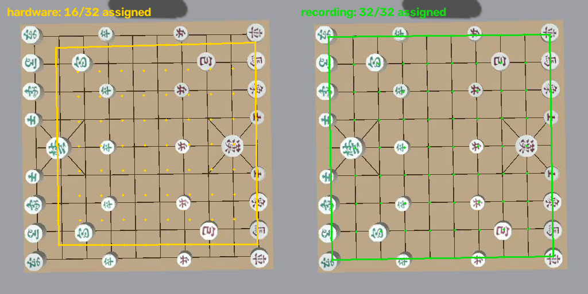

# 녹화 격자 불일치와 프레임 저하 진단

## 격자 불일치: 보정 선택 문제

사용자 재생 세션 `session_20261111_215701_157453`은 Gazebo MP4에 실물 보정
`src/janggi/calibration/config/calibration.yaml`을 사용했다. 같은 영상 폴더의
`calibration.yaml`은 평평한 Gazebo 판(윗면 Z=−20mm)에 맞는 녹화 당시 보정이다.
카메라 내부 파라미터와 영상 크기 1280×720은 녹화 메타데이터와 일치한다.

동일한 첫 프레임·동일한 검출 32개에서 보정만 바꿔 비교했다.

| 보정 | 교차점 할당 | 가까운 교차점까지 거리 평균(칸) |
|---|---:|---:|
| 실물 기본값 | 16/32 | 0.344 |
| 녹화 폴더 보정 | 32/32 | 0.011 |

파일 입력 시 옆 보정을 자동 선택하도록 수정했다. 명시적인 `--calibration`은 유지한다.
이는 격자/할당 문제 수정이며 CNN의 종류 분류 오차까지 해결했다는 의미는 아니다.

## 영상 전달 경로 병목

모델 추론 없이 영상 토픽만 구독해 비교했다. 도구 환경에서 측정했으며 사용자 GPU 실행의
전체 프로파일이나 DDS 내부 함수별 원인 분석으로 해석하면 안 된다.

| 수신자 | 현실 시간 FPS |
|---|---:|
| 동시 비교 Gazebo 원본 | 29.90 |
| 동시 비교 ROS Python | 11.21 |
| ROS C++ 단순 구독자 | 10.30 |
| 실제 UI 가상환경의 원본 입력 어댑터 | 29.74 |
| 실제 UI 가상환경의 ROS 입력 어댑터 | 6.20 |

UI 어댑터 내부 RGB/BGR 복사는 원본 경로 평균 6.29ms, ROS 경로 평균 4.67ms였다.
C++에서도 ROS 경로가 느렸으므로 Python 변환이나 CNN만의 문제는 아니다.
추가 비교에서는 C++ 수신자의 QoS 신뢰성만 Best Effort → Reliable로 바꾸자 **약 10.30 → 31.02 FPS**가 됐다.
실제 UI 입력 어댑터도 Reliable/KEEP_LAST(1) 변경 후 **약 6.20 → 21.35 FPS**로 개선됐다.
그때 원본 직접 수신은 약 27.95 FPS였다. 측정 창의 부하 차이는 있으며, 이는 커널 패킷/단편 재전송을 직접 추적한 결과는 아니다.
이 환경의 Best Effort 영상 전달 손실이 주요 요인으로 확인돼 ROS 비교용 경로도 Reliable로 수정했다.

기본 UI 입력을 Gazebo 원본 직접 구독으로 전환하고, 사용하지 않는 ROS 영상 브리지는 기본 OFF로 바꿨다.
ROS 모드는 비교용으로 남긴다. 원본 수신이 30 FPS여도 YOLO/CNN이 느리면 처리 FPS는 낮다.
실제 UI 통합 smoke는 CPU를 명시하여 실행했으며 원본 입력 약 25 FPS·처리 약 2 FPS가 관측됐다.
프로파일에서 원본 입력 대기는 평균 약 3.6ms, YOLO는 약 614ms, 추적/저장은 약 22ms였다.
녹화 파일도 CPU에서 YOLO 약 472ms·처리 약 2 FPS였다. 비동기 CNN 배치 시간은 약 698~835ms였고 프레임 시간과 단순 합산하면 안 된다.
이는 사용자의 CUDA 성능 측정이 아니라, 수신 빈도와 처리 빈도를 구분해야 함을 보여주는 재현이다.

hybrid 세션의 `performance.json`에 입력·YOLO·추적/저장·출력, CNN 배치 시간과 장치를 남기도록 했다.

- [수신 경로 측정 수치](transport_comparison.json)
- [격자 비교 수치](calibration_comparison.json)
- [수정 후 녹화 UI](recorded_ui_fixed.png)

## 적용 및 검증

UI 기본 입력은 Gazebo 원본 직접 수신이며, ROS 영상 브리지는 새 launch에서 기본 OFF다.
비교용 ROS 경로는 launch `camera_bridge:=true`와 UI `--gazebo-transport ros`로 선택한다.
변경 후 기존 UI를 실제 라이브 입력과 녹화 입력으로 각각 실행했고, 두 경우 모두 검출·판 할당 32개와 정상 종료를 확인했다.
녹화 입력은 보정 옵션 없이 옆 `calibration.yaml`을 자동 선택했다. 관련 테스트 **147개**가 통과했다.

- [라이브 CPU 구간별 프로파일](live_performance.json)
- [녹화 CPU 구간별 프로파일](recorded_performance.json)
